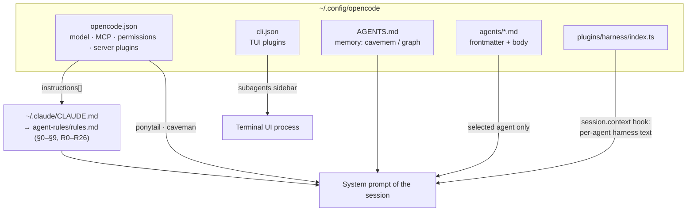
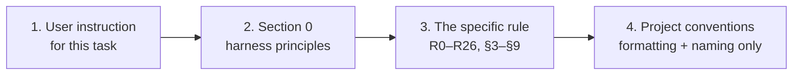
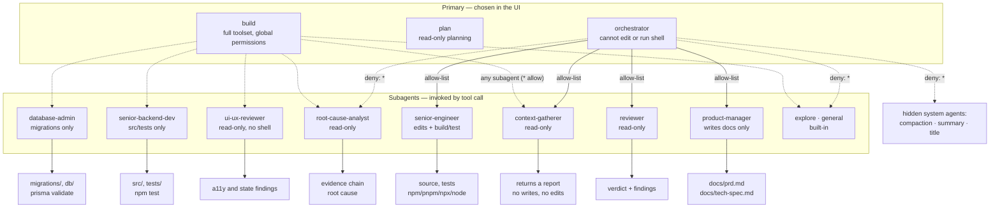
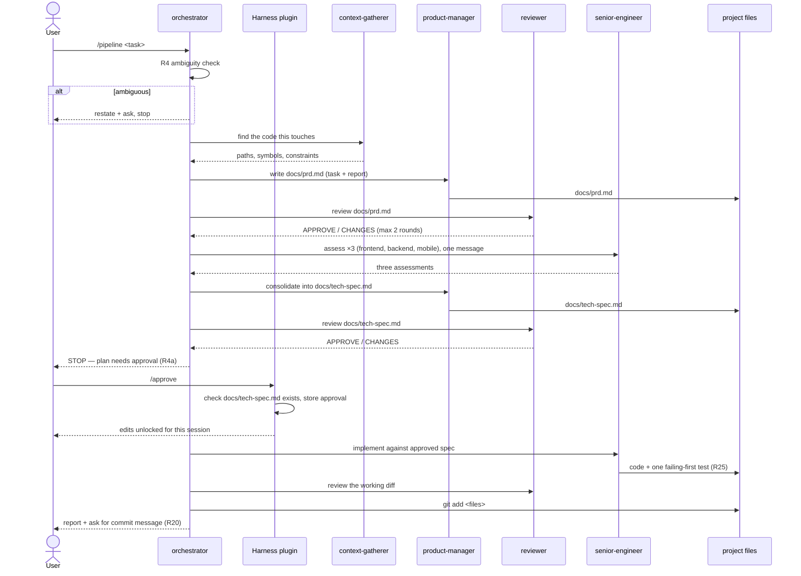
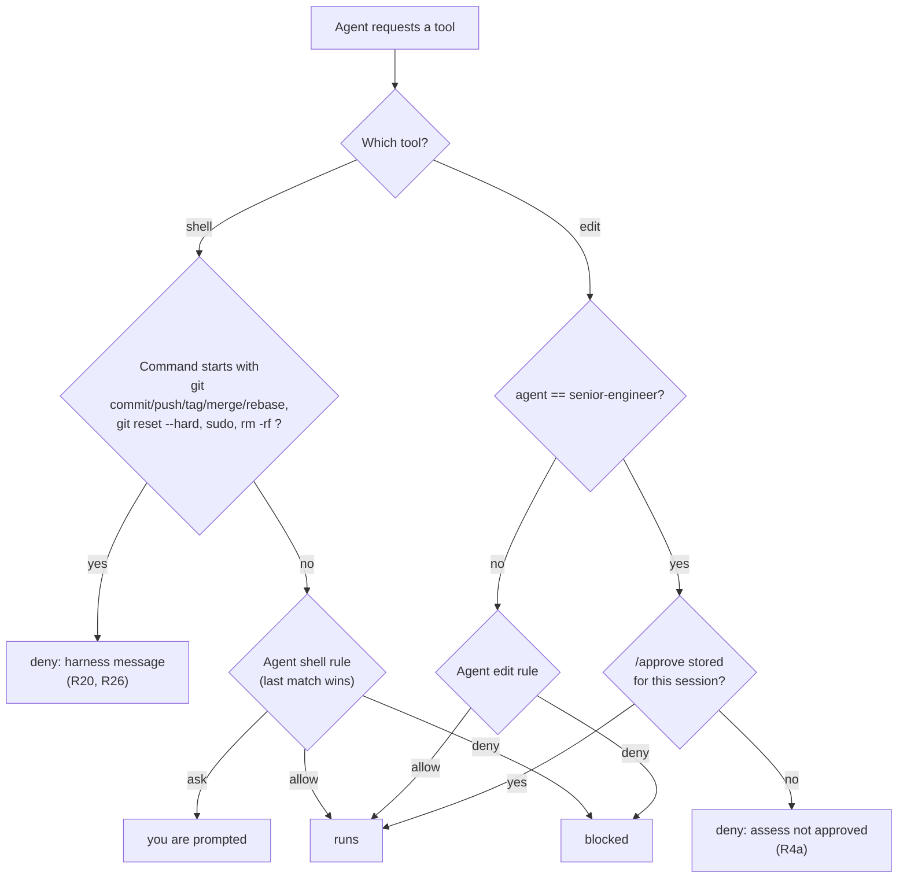

# Harness architecture — current setup

How this machine's OpenCode harness is wired: which rules load, which agents exist,
who may call whom, and where each rule is actually enforced.

Verified against the live setup (OpenCode `v2.3.0`, `opencode debug agents`, plugin
log, `~/.config/opencode/*`). If the config changes, re-check with the commands in
[Verifying](#verifying).

## Snapshot

| Piece | Path / value |
| --- | --- |
| Global config | `~/.config/opencode/opencode.json` |
| Engineering rules | `~/.claude/CLAUDE.md` → symlink to `~/Documents/projects/agent-rules/rules.md` (same bytes as `rules.md` in this folder) |
| Memory rules | `~/.config/opencode/AGENTS.md` |
| Custom agents | `~/.config/opencode/agents/*.md` — primary `orchestrator`; subagents `context-gatherer`, `product-manager`, `reviewer`, `senior-engineer`, `root-cause-analyst`, `ui-ux-reviewer`, `senior-backend-dev`, `database-admin` |
| Pipeline command | `~/.config/opencode/commands/pipeline.md` → `/pipeline <task>` |
| Browser command | `~/.config/opencode/commands/browser.md` → `/browser <task>` (Playwright CLI; multi-step work uses the MCP) |
| Enforcement plugin | `~/.config/opencode/plugins/harness/index.ts` (local, loaded by absolute path) |
| Server plugins | `@dietrichgebert/ponytail@latest`, `@mumme-it/opencode-caveman@1` |
| TUI plugins | `~/.config/opencode/cli.json` → `opencode-plugin-subagents-sidebar` |
| Ponytail | `@dietrichgebert/ponytail@latest`, level `full` |
| Caveman | `@mumme-it/opencode-caveman@1`, default level `full`, switching via `/caveman` |
| Default model | `opencode-go/glm-5.3`; `build` and `plan` = `deepseek-v4.1-flash#high`; agents without a model inherit the session model |
| MCP servers | `cavemem`, `graph` (`~/.local/share/opencode/knowledge-graph.jsonl`), `playwright` (Chromium via `@playwright/mcp`), `unity` |

## 1. What loads into a session

Three separate input paths feed the model: config-declared instructions, agent
definitions, and plugin hooks. Only the rules file is global prose; the rest is
scoped to the agent running.



- `instructions` names exactly one file: `~/.claude/CLAUDE.md`. That is the single
  source of truth — `rules.md` on the Desktop and in `agent-rules/` are the same file.
- `AGENTS.md` is picked up by convention and carries only memory rules (search
  before writing, no secrets in memory).
- An agent's Markdown body is not global: it replaces the default prompt only for
  that agent.
- The local plugin appends a short, agent-specific reminder to the system prompt —
  see `RULES_BY_AGENT` in `index.ts`.
- Two kinds of plugin, two files and two processes:

| Kind | File | Process | Examples | Effect |
| --- | --- | --- | --- | --- |
| Server plugin | `opencode.json` → `plugins` | server | `ponytail`, `@mumme-it/opencode-caveman@1`, local `harness` | system prompt, tools, permissions, commands |
| TUI plugin | `cli.json` → `plugins` | terminal UI | `opencode-plugin-subagents-sidebar` | rendering only: sidebar, panels, keybinds |

- `opencode plugin add` writes server plugins to `opencode.json` and TUI plugins to
  `cli.json` automatically. A TUI plugin is not active until the TUI restarts.
- Plugins must target the V2 API (`@opencode/plugin`, `Plugin.define({ id, setup })`).
  V1 packages (`@opencode-ai/plugin`, a bare function export) fail at load with
  "Plugin must export a default definition with an id and an effect or setup
  function". `opencode-caveman` and `caveman-opencode-plugin` are V1; they are not
  usable on 2.3.0.
- Ponytail and caveman both compress replies. Ponytail governs what code to write;
  caveman governs how chat text reads. Neither changes permissions.

## 2. The rules model

`rules.md` is layered, and collisions have a fixed order:



| Layer | Contents | Purpose |
| --- | --- | --- |
| §0 | 13 principles + precedence | Executive summary; wins over individual rules |
| R0–R3 | KISS/YAGNI, defensiveness, no magic strings/numbers | Shape of every change |
| R4, R4a | Ask before assuming; phased checkpoints | Process |
| R5–R11 | DRY, size limits, error handling, naming, nesting | Local code quality |
| R12–R14 | Async UI guards, SOLID/DI, reuse first | Design |
| R15–R17b | Comments, no debug output, `const`, async loops, no `any` | Hygiene |
| R20, R25, R26 | User writes commits; tests prove the change; security baseline | Non-negotiables |
| R21 | Data / business-logic / presentation separation | Architecture |
| §4 | The database is a dumb store (no FKs, cascades, triggers, business `ENUM`) | Schema |
| §5 | Two pre-code checklists + prohibition tables | Review gate |
| §7 | Subagent registry and role contracts | This harness |
| §6, §8, §9 | Behaviour, stack rules, guardrails | Background |

§7 is worth reading closely: it is the contract this setup actually implements.

## 3. Agents

OpenCode distinguishes **primary** agents (you pick them and talk to them) from
**subagents** (only reachable through a tool call from another agent). A subagent
runs in its own session with a fresh context: it does not see the parent's
conversation unless the caller passes the relevant text in the prompt.



The orchestrator's allow-list is the load-bearing part: `subagent * deny`, then four
explicit allows. It cannot reach `explore`, `general`, the hidden agents, or the four
§7 registry agents. `build` has no such limit, so casual sessions can still delegate
freely — and that is the route to the registry agents.

To let the pipeline use one of them, add a matching
`{ "action": "subagent", "resource": "<agent-id>", "effect": "allow" }` rule to
`agents/orchestrator.md`.

| Agent | Edit | Shell | Can spawn subagents | Job |
| --- | --- | --- | --- | --- |
| `build` | allow | ask, git/read-only allowed | yes, any | Default coding agent |
| `plan` | deny except `~/.opencode/plan/*` | ask, git/read-only allowed | yes | Explore and plan |
| `orchestrator` | deny | git status/diff/log/add, `rg`, `ls` only | 4 named only | Sequences the pipeline |
| `context-gatherer` | deny | git + `rg`/`ls` only | — | Find the code a task touches |
| `product-manager` | allow | git status, `rg`, `ls` | — | Write PRD / tech spec |
| `reviewer` | deny | git + `rg`/`ls` only | — | Review a doc or the diff |
| `senior-engineer` | allow (gated) | git, `rg`/`ls`, `npm run/test`, `pnpm`, `yarn`, `npx`, `node` | — | Assess one stack, then implement |
| `root-cause-analyst` | deny | git, `rg`/`ls`, `npm test`, `npx tsc` | — | Find the true cause of a defect |
| `ui-ux-reviewer` | deny | none | — | Review UI: a11y, states, layers |
| `senior-backend-dev` | `src/`, `tests/`, `test/`, `e2e/`, `package.json`, `tsconfig.json` | git status/diff/log, `npm run/test/ci`, `npx tsc`, `node` | — | Implement one backend area |
| `database-admin` | migrations, `db/`, `schema/`, `*.sql` | git status/diff/log, `npx prisma validate/format` | — | Schema and migrations |

The last four are the §7 registry roles, added to match the constitution:

| §7 role | Agent id | Writes | Contract |
| --- | --- | --- | --- |
| `root-cause-analyst` (alias `bug-reviewer`) | `root-cause-analyst` | nothing | Evidence chain, not a guess |
| `ui-ux-reviewer` | `ui-ux-reviewer` | nothing | States, a11y, layers, forms |
| `senior-backend-dev` | `senior-backend-dev` | `src/`, tests, package files | One area, test fails first |
| `database-admin` | `database-admin` | migrations, `db/`, `schema/` | §4 dumb database, reversible |

`senior-engineer` stays as the pipeline's stack assessor and implementer; the
registry agents are narrower and are not part of the `/pipeline` sequence by default.

Agent permission rules are appended after the global ones; the later, more specific
rule decides. That is why `shell * deny` plus `shell git status* allow` yields "git
status only".

## 4. The pipeline

`/pipeline <task>` runs `commands/pipeline.md`, which pins the session to the
`orchestrator` agent and forwards the task text. The orchestrator writes no code
itself — it sequences, keeps artifacts, and reports.



Phase table:

| # | Step | Artifact | Stop? |
| --- | --- | --- | --- |
| 0 | Restate task, R4 check | — | yes, if ambiguous |
| 1 | `context-gatherer` | report back to orchestrator | — |
| 2 | `product-manager` | `docs/prd.md` | — |
| 3 | `reviewer`, ≤2 rounds | — | — |
| 4 | `senior-engineer` ×3, then merge | `docs/tech-spec.md` | — |
| 5 | `reviewer`, ≤2 rounds | — | — |
| 6 | Report the plan | — | **yes — approval gate** |
| 7 | `senior-engineer` implements | code + tests | — |
| 8 | `reviewer` on diff, stage, ask | — | **yes — R20** |

Three parallel `senior-engineer` calls are bounded fan-out (R17a) and only safe
because the stacks are file-disjoint; the orchestrator falls back to sequential when
they touch the same files. No subagent talks to another: the orchestrator is the
only channel, and the files are the only shared state.

## 5. Where each rule is actually enforced

Rules reach the model as prose, so most of them are **soft**: an agent can violate
them and only the reviewer or you will catch it. A few are **hard**, enforced by
permissions or the plugin.

| Rule | Enforcement | Hard? |
| --- | --- | --- |
| R4 ambiguity stop | prompt (orchestrator, all agents) | soft |
| R4a phase checkpoints | `/approve` gate on `senior-engineer` edits | **hard** |
| R20 user writes commits | plugin `FORBIDDEN_SHELL` regex | **hard** |
| R26 no sudo / no wipes | plugin regex + `sudo *` deny in config | **hard** |
| R21 layer separation | reviewer checklist + agent prompts | soft |
| R25 test proves the change | reviewer checklist + senior-engineer prompt | soft |
| R14 reuse first | context-gatherer prompt | soft |
| §4 dumb database | `product-manager` prompt for `tech-spec`, reviewer | soft |
| Read-only roles | `edit * deny` on 3 of 4 subagents | **hard** |
| Orchestrator can't code | `edit * deny` + `shell * deny` | **hard** |
| Bounded fan-out | orchestrator prompt | soft |

The gate is per session, not per project: `/approve` stores
`approve/<sessionID>` in plugin storage after checking that
`docs/tech-spec.md` exists in the session directory. A new session starts locked.



Limits worth knowing:

- The shell block is a regex on the command's start, not a sandbox. `cd src && git commit`
  does not match. It stops the intended path, not a determined agent.
- Only `senior-engineer` is edit-gated. `product-manager` and `build` can write before
  approval; the gate protects implementation, not documents.
- `plan` and `build` ignore the pipeline entirely — they are for ordinary sessions.

## 6. Artifacts

Everything the pipeline produces lives in the **session directory** (the project),
not in the config:

```
docs/prd.md         what to build, owned by product-manager
docs/tech-spec.md   how to build it, consolidated by product-manager
```

They are the only state the phases share. Delete them between tasks or the next
pipeline inherits a stale plan.

## 7. Browser tooling

Two Playwright paths. The MCP server, named `playwright`, drives Chromium for
multi-step interaction. The `/browser` command does one-shot captures through the
CLI. Both use Chromium; the server key was `firefox` in an earlier version.

| Item | Value |
| --- | --- |
| Server key | `playwright` (was `firefox`) |
| Command | `npx -y @playwright/mcp@0.0.84` (no `--browser` flag → Chromium) |
| Tool namespace | `playwright` — about 25 tools: click, type, snapshot, evaluate, console |
| Browser builds | `~/.cache/ms-playwright/chromium-1252` + `chromium_headless_shell-1252` for the MCP; `chromium-1255` + `chromium_headless_shell-1255` for the CLI |
| Playwright version behind the MCP | `1.65.0-alpha-2026-10-30` (pinned by the MCP package) |

Install the browser with the MCP's own Playwright build, not with a different
global Playwright version; the revision numbers must match:

```bash
npx -y @playwright/mcp@0.0.84 --help >/dev/null
node "$HOME/.npm/_npx"/*/node_modules/playwright-core/cli.js install chromium
```

The global permissions allow `npx -y playwright *` so `/browser` runs without a
prompt. Every other shell command still asks. MCP tools are exposed under their own
namespace and are not governed by shell permissions.

The `/browser` command (`commands/browser.md`) is the second path: `npx -y
playwright` handles one-shot work — screenshot, PDF, codegen, `playwright test` —
and writes artifacts to `/tmp/opencode/playwright/`. It runs Playwright 1.65.1 and
needs its own browser build:

```bash
npx -y playwright install chromium   # chromium_headless_shell-1255
```

Use the MCP for multi-step interaction (click, fill, login, scrape). npx does not
expose the `playwright` module to `node`, so a script that imports it fails.

Headless shell is used for headless runs; full Chromium is used when the MCP opens a
visible window.

## Verifying

```bash
opencode plugin list                 # harness (local) + ponytail
opencode debug agents                # effective agents and permission lists
opencode debug config                # config sources actually loaded
opencode mcp list                    # cavemem, graph, playwright, unity
grep -i harness ~/.local/share/opencode/log/opencode.log | tail
```

If `harness` is missing from `plugin list`, the `/approve` command, the shell block,
and the per-agent prompt text are all inactive — the pipeline then runs on prompts
alone.

## Quick reference

| Action | Command |
| --- | --- |
| Run the full pipeline | `/pipeline <task>` |
| Run a browser capture | `/browser screenshot <url>` (Playwright CLI) |
| Unlock implementation | `/approve` (needs `docs/tech-spec.md`) |
| Change reply compression | `/caveman lite`, `/caveman full`, `/caveman ultra`, `/caveman off` |
| Add a plugin | `opencode plugin add <package>` (server → `opencode.json`, TUI → `cli.json`) |
| Switch to a free-form session | pick `build` / `plan` in the UI |
| Change the engineering rules | edit `~/Documents/projects/agent-rules/rules.md` (symlinked; no restart needed) |
| Change an agent | edit `~/.config/opencode/agents/<name>.md`, new session picks it up |
